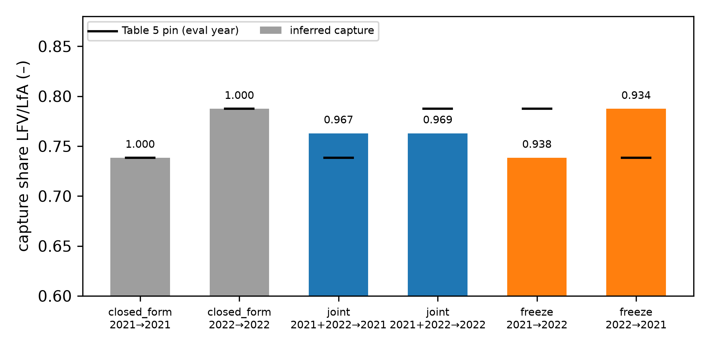
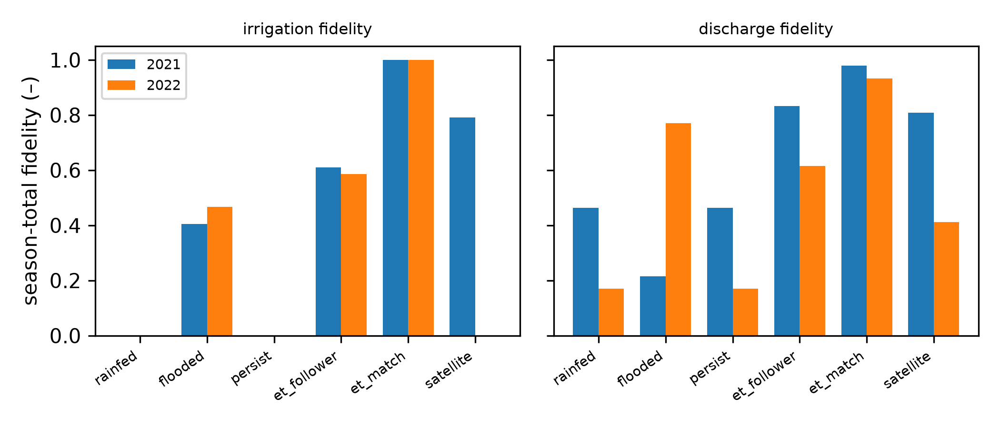

> **Canonical single manuscript:** [ems_full_manuscript.md](ems_full_manuscript.md)

# CyclicEnv: an open Gymnasium environment and benchmark for learning unobserved water fate in a cyclic-irrigation paddy district

**Target journal:** *Environmental Modelling & Software* (Elsevier)  
**Article type:** Research / environmental modelling software  
**Draft date:** 25 September 2026  
**Authors:** [names, affiliations, ORCID — to be completed]  
**Corresponding author:** [name, e-mail]  
**Software:** CyclicEnv (`cyclic-irrigation`, `import cyclic`), version 0.2.0  

---

## Highlights

- Open Gymnasium environment for a 4,925-paddy cyclic-irrigation district
- Known pump and drainage forcing isolates unobserved leftover water fate
- Separate farmer, ratio and hop-law slots with per-role observation masks
- Joint two-year leftover capture reaches 0.97 fidelity to water-balance pins
- Baselines expose year instability, oracle leakage and a strong zero-discharge null

---

## Abstract

Cyclic irrigation reuses paddy drainage by pumping it back into the supply canal, but the subsurface part of that reuse—lateral seepage through bunds and its recapture at the pumping station—is not measured at plot scale and is known only as a district water-balance residual. We present CyclicEnv, an open-source Python package that turns the published two-season water balance of the Imbanuma cyclic-irrigation district (Chiba, Japan; Okura et al., 2025) into a Gymnasium reinforcement-learning and inverse-modelling environment over 4,925 paddy polygons. Surface irrigation and drainage are supplied as known forcing, so learning concentrates on the unobserved partition of each plot's leftover water into same-day recapture, neighbour exchange and on-plot storage. Three registered learner slots—a farmer policy, a leftover-ratio model and a neighbour-head hop law—receive different observation channel packs that can be hidden or shown for ablation. An optional Copernicus Data Space client retrieves Sentinel-2 scenes over the district. Year-holdout protocols and reference results establish what a year-invariant capture field can and cannot achieve: joint training recovers each year's Table 5 recapture pin with fidelity 0.967 and 0.969, versus 0.934–0.938 for a single-year freeze. Farmer baselines range from 0.09 to 0.99 season-total fidelity; an oracle that sees observed block totals dominates irrigation scores, and a satellite-driven rule collapses from 0.80 in the wet year to 0.21 in the dry year. Fitted hop laws can beat the physics teacher on holdout, but per-paddy variants overfit. In the known-irrigation gym, a zero-discharge policy obtains the highest mean reward among the rules tested. CyclicEnv is offered as a stable, reproducible benchmark for district-scale water-fate learning and simulation-based optimisation, not as a claim of a best algorithm.

**Keywords:** cyclic irrigation; paddy water balance; return-flow reuse; Gymnasium; reinforcement learning environment; inverse modelling; simulation optimisation; partial observability; Sentinel-2; reproducible benchmark

---

## Software availability

| Item | Detail |
|---|---|
| Software name | CyclicEnv (`cyclic-irrigation`, import name `cyclic`), version 0.2.0 |
| Developers | [to be completed] |
| Contact | [e-mail] |
| Year first available | 2026 |
| Hardware | Standard PC or laptop; about 2 GB RAM for a full 4,925-paddy season |
| Operating system | Windows, Linux, macOS (developed and tested on Windows 11) |
| Program language | Python ≥ 3.10 (tested on 3.14.0) |
| Dependencies | numpy, pandas, scipy, requests; `[gym]` adds gymnasium, geopandas, shapely, pyogrio, xarray, netCDF4; optional matplotlib, solara |
| Installation | `pip install -e ".[ems]"` |
| Gymnasium IDs | `Cyclic-Imbanuma-v0` (irrigation known), `Cyclic-Imbanuma-Open-v0` (irrigation is an action) |
| Tests | 96 unit and integration tests |
| Reproduction | `python scripts/ems_experiments.py` regenerates every table and figure |
| Licence | MIT |
| Availability | [repository URL and Zenodo DOI to be added on submission] |

---

## 1. Introduction

### 1.1 Cyclic irrigation and unobserved leftover water

In flat, low-lying paddy districts, cyclic irrigation collects drainage in a main canal and pumps it back into the supply (Takeda et al., 1997; Hama et al., 2010, 2013). The practice reduces lake or river withdrawals and can retain nutrients and suspended solids inside the district. Okura et al. (2025) monitored the Shiroyama–Jinbee area of the Imbanuma Land Improvement District (Chiba, Japan) in 2021 and 2022 with pump records and ADCP drainage measurements. Subsurface lateral flow from paddies emerged as a large residual term, and drought changed both water-use efficiency and the cyclic reuse ratio.

That residual is the modelling target. Plot-scale leftover \(L = IR + R - D - ET\) is not observed paddy by paddy; only season block totals and pump-station recapture \(LFV_{\mathrm{pump}}\) are known. Bund seepage and preferential pathways move water laterally (Walker and Rushton, 1986; Bouman et al., 1994; Huang et al., 2003; Janssen and Lennartz, 2007, 2008; Janssen et al., 2009), and toposequence water-balance models make lateral movement first-class (Tsubo et al., 2005, 2007). Watershed tools such as SWAT-Paddy improve ponding representation but still under-represent rapid return flow through drainage systems (Tsuchiya et al., 2018). CyclicEnv does not invent a new field campaign; it turns Okura's published identities into a learnable software problem.

Accounting language matters. Irrigation “efficiency” gains can raise basin consumption (Seckler, 1996; Perry, 2007; Ward and Pulido-Velázquez, 2008; Grafton et al., 2018). The package therefore scores reuse and capture (\(LFV_{\mathrm{pump}}/LfA\)) and keeps surface IR/D as known forcing rather than claiming “saved” water from a black-box policy.

### 1.2 Learning environments and open environmental software

Sequential decision tools need a shared contract: spaces, `reset`/`step`, rewards and seeds (Sutton and Barto, 2018). OpenAI Gym established that contract (Brockman et al., 2016); Gymnasium is the maintained standard (Towers et al., 2024). Agricultural gyms wrap process models for fertilisation or field irrigation (Overweg et al., 2021; Gautron et al., 2022; Kelly and Foster, 2021; Kelly et al., 2024). Basin tools such as MORL4Water address reservoir networks (Osika et al., 2025, 2026). None of these packages represents thousands of paddies exchanging water through bunds into a shared cyclic pool, with the key flux known only as an aggregate residual.

*Environmental Modelling & Software* has a long line of open water-modelling software—Pywr (Tomlinson et al., 2020), Pywr-DRB (Hamilton et al., 2024), plugin architectures (Massoudieh et al., 2023), pytRIBS (Raming et al., 2025)—and related work on operation and learning around simulators (Giuliani et al., 2016; Herman and Giuliani, 2018; Jordan et al., 2022; Hong et al., 2023; Maier et al., 2014). CyclicEnv sits in that software lineage, with Gymnasium as the front door and simulation-based optimisation and inverse modelling as intended uses.

### 1.3 Purpose, contributions and stance

We follow EMS guidance on credible model development: state purpose and data roles, evaluate against held-out information, use several performance measures, and publish code and workflows (Jakeman et al., 2006; Kelly et al., 2013; Bennett et al., 2013; Hutton et al., 2016; Lemmen et al., 2024). FAIR principles for data and research software apply (Wilkinson et al., 2016; Barker et al., 2022). Year splits matter for learned hydrology (Gauch et al., 2021; Kratzert et al., 2019); equifinality warns that many leftover fields can hit the same pin (Beven, 2006). The scientific stance is hybrid process plus learning (Reichstein et al., 2019; Shen, 2018; Nearing et al., 2021): FAO-56 and Okura identities stay fixed; only the unobserved leftover partition and optional hop laws are learnable.

The contributions of this article are:

1. A pip-installable Gymnasium environment of a real cyclic-irrigation district (4,925 paddies, two seasons), with registered environment IDs and a native multi-role API.
2. A decomposition into three registered slots—farmer, leftover ratio and hop law—with known surface forcing, aggregate constraints and simulator teachers kept separate.
3. Per-role observation channel packs that support partial-observability studies and block obvious shortcuts.
4. Year-holdout evaluation protocols and reference results, including negative and degenerate findings.
5. Optional Copernicus Data Space access for Sentinel-2 over the district.

We do not claim a new hydrological measurement, unique identification of subsurface paths, or a state-of-the-art learning algorithm.

---

## 2. Study system and data

### 2.1 Site and season

The environment represents the Shiroyama–Jinbee cyclic irrigation area beside Lake Kita-Imbanuma, Chiba, Japan (Okura et al., 2025). The district is divided into North and South blocks drained by a main drainage canal that converges at a pumping-station pool; the pool supplies irrigation to both blocks, with a lake withdrawal making up any shortfall. The irrigation season runs from 17 April to 25 August (131 days). Two seasons are available: 2021 (wet) and 2022 (dry).

The package's parcel layer contains 4,925 paddy polygons, of which 2,061 lie inside the cyclic-irrigation command area; the rest are carried in the model for spatial context and are excluded from the recapture pins.

### 2.2 Forcing, constraints and teachers

Table 1 separates every data source by its role. This separation is the central design decision: it determines what a learner may see, what it is scored against, and what cannot be claimed.

**Table 1.** Data roles in CyclicEnv.

| Role | Quantity | Source | Resolution |
|---|---|---|---|
| Known forcing | Block irrigation IR, lake withdrawal W | Okura et al. (2025), Fig. 8, digitised | daily, per block |
| Known forcing / label | Block surface drainage D | Okura et al. (2025), Fig. 6 monthly ADCP, scaled by 0.881 to match Table 4 | monthly shape, daily values |
| Aggregate constraint | Block leftover LfA, pump recapture LFV_pump, storage change | Okura et al. (2025), Tables 4–5 | season totals |
| Weather | Precipitation, ET0 and other meteorology | Open-Meteo archive | daily, district |
| Remote sensing target | NDVI-derived Kc × ET0 | Sentinel-2 | per pass, per pixel |
| Simulator teacher | Plot-scale neighbour hop ΔL | Physics hop operator (Section 3.4) | daily, per paddy |

Two limitations are stated here rather than deferred. The daily irrigation series are digitised from a published figure, not the original logger files, and the daily drainage series is a monthly ADCP shape rescaled to the season table. Digitised Fig. 8 North and South season volumes match Table 4 cyclic IR (about 9,798 ×10³ m³ in 2021 and 10,209 in 2022), not Table 5 IR_all (about 14,734 and 15,414). The package therefore pins Fig. 8 onto cyclic paddies and adds non-cyclic (NCB) supply separately so that IR_all = IR_cyclic + IR_ncb (Okura Eq. 5). Neither the digitised figure nor the rescaled monthly drainage is a substitute for the original campaign logger files, which the package can ingest when available.

### 2.3 Remote sensing

Satellite evapotranspiration targets follow the widely used approach of deriving a crop coefficient from NDVI and multiplying by reference ET (Allen et al., 1998; Er-Raki et al., 2007). They are used as a scoring target and as an observation channel, not imposed as the simulated flux. The `cyclic.copernicus` module registers Copernicus Data Space Ecosystem credentials locally (`python -m cyclic copernicus register`) and searches or downloads Sentinel-2 products over the district bounding box.

---

## 3. Model

### 3.1 District identities

The environment reproduces the water-balance identities of Okura et al. (2025). For block \(b\) and season \(y\), the leftover (lateral flow) is the residual

\[
L_b = IR_b + R - D_b - ET_b, \tag{1}
\]

the pump-pool balance yields the same-day lateral-flow recapture

\[
LFV_{\text{pump}} = IR_{\text{all}} - W + O - D_N - D_S, \tag{2}
\]

and the storage change retained in the blocks is

\[
\Delta WB = LfA_N + LfA_S - LFV_{\text{pump}}, \tag{3}
\]

where \(LfA_b\) is the block leftover volume, \(W\) the lake withdrawal and \(O\) the pool outflow. The district recapture ratio for a season is

\[
c_y = \frac{LFV_{\text{pump},y}}{LfA_{N,y} + LfA_{S,y}}, \tag{4}
\]

giving \(c_{2021} = 0.7384\) and \(c_{2022} = 0.7873\) from Tables 4–5.

### 3.2 Plot water balance

Each paddy carries a pond, a topsoil evaporable store and a root-zone store. Daily evapotranspiration uses the FAO-56 dual crop coefficient (Allen et al., 1998), splitting evaporation from the pond or topsoil and transpiration from the root zone, with total evaporable water TEW = 25 mm and total available water TAW = 100 mm by default. Pond-to-soil infiltration through the plough pan is a physics rate proportional to pond depth, capped at the pond. Plot leftover is

\[
L_i = IR_i + R - D_i - ET_i. \tag{5}
\]

### 3.3 Leftover simplex

Positive leftover at paddy \(i\) is partitioned once:

\[
L_i^{+} = \big(k^{\text{cap}}_i + k^{x}_i + k^{y}_i + k^{z}_i + k^{g}_i\big)\,L_i^{+}, \qquad \sum k = 1, \tag{6}
\]

where \(k^{\text{cap}}\) is same-day recapture to the pump pool (only infiltrated leftover can be recaptured), \(k^{x} + k^{y}\) is exchange with neighbouring plots, and \(k^{z} + k^{g}\) is on-plot storage (topsoil and deeper soil). The closed form used as a reference pins the district mean of \(k^{\text{cap}}\) to \(c_y\), sends a fraction \(\rho = 0.5\) of the remainder to neighbours, and splits storage by TEW/(TEW+TAW) = 0.2. The east–west versus north–south split of neighbour exchange is not identifiable from the data and is reported as equal halves.

A spatial field of \(k^{\text{cap}}_i\) is built from canal proximity and the North/South leftover intensity of Okura's Table 4, then rescaled so that its area-weighted mean over cyclic paddies equals the target district ratio.

### 3.4 Neighbour hop operator

Leftover moves between paddies on a four-neighbour graph (north, south, east, west). The physics operator `head_equalise` moves infiltrated leftover only from a wetter to a drier neighbour, never beyond equal head, at bund-seepage scale. It uses no soil hydraulic conductivity and no knowledge of how irrigation was split among plots. Because plot-scale exchange is not observed, this operator is also the teacher against which learned hop laws are fitted (Section 5.4); we make no claim that it is correct in the field.

### 3.5 Pumping station

A pumping-station agent closes Eq. (2) daily. It collects block drainage and recaptured leftover in the pool, withdraws lake water to meet irrigation demand, and spills outflow; when digitised withdrawals are supplied they are followed as a hard copy.

---

## 4. Software design

### 4.1 Architecture

```text
             pip install -e ".[ems]"
                       │
   gymnasium.make("Cyclic-Imbanuma-v0")   ◄── Gymnasium API (CyclicGym)
                       │
              cyclic.CyclicEnv            ◄── native multi-role API
     ┌─────────────────┼──────────────────┐
     │  observation channel packs (hide/show per role)
     ▼                 ▼                  ▼
 farmer slot       ratio slot        hop-law slot
 @register_        @register_        @register_
  forecaster        ratio             lateral
     │                 │                  │
     └──────► CyclicModel (FAO-56 plots, leftover simplex,
              neighbour graph, pumping station, Okura identities)
                       │
        data: parcels · Okura tables/figures · Open-Meteo · Sentinel-2
```

**Fig. 1.** Package layers. Learners never modify the physics core; they are plugged in through registries and see only the channels assigned to their role.

`CyclicModel` advances all paddies with vectorised numpy arrays rather than per-plot objects, so a 131-day season over 4,925 paddies runs in about 8 s in the native loop. `CyclicEnv` wraps the model as a daily decision process with rewards and multi-role observations. `CyclicGym` is a thin `gymnasium.Env` subclass registered as `Cyclic-Imbanuma-v0` and `Cyclic-Imbanuma-Open-v0` through a `gymnasium.envs` entry point.

### 4.2 Gymnasium interface

```python
import gymnasium as gym
import cyclic.gym_env   # registers the environment IDs

env = gym.make("Cyclic-Imbanuma-v0", year=2022, obs_role="farmer")
obs, info = env.reset(seed=0)            # obs: float32 array (4925, 50)
action = env.action_space.sample()       # discharge, mm per paddy
obs, reward, terminated, truncated, info = env.step(action)
eq_view = info["obs_equation"]           # other roles' observations
```

In `Cyclic-Imbanuma-v0` irrigation is pinned to the digitised Okura block totals and the action is per-paddy surface discharge, a `Box(0, 200, (4925,))`. In `Cyclic-Imbanuma-Open-v0` the action is a `Box(0, 200, (4925, 2))` of irrigation and discharge. The observation is a `Box` over the visible numeric channels of the active role, with missing values set to zero so observations always lie inside the space. An episode is one season (131 steps).

The daily reward is an area-weighted combination of terms of the form \(\exp(-|\text{sim} - \text{obs}|/s)\) for block drainage, satellite ET, block leftover and pump recapture. The irrigation term is weighted zero when irrigation is known forcing.

### 4.3 Learner slots

| Slot | Decorator | Base class | Interface | Registered baselines |
|---|---|---|---|---|
| Farmer | `@register_forecaster` | `FarmerPolicy` | `decide_batch(obs) → (irrigation_mm, discharge_mm)` | rainfed, flooded, persist, et_follower, et_match, satellite, et_net, linear, … |
| Leftover ratio | `@register_ratio` | `RatioPolicy` | `partition(leftover, obs, targets) → shares` | tables, frozen_stay |
| Hop law | `@register_lateral` | `LateralPolicy` | `flux(stock, graph, area, physics, …) → (after, delta)` | head_equalise, linear, nonlinear |

Hop laws must not take soil conductivity or the irrigation split as arguments; a check in the holdout routine inspects the `flux` signature and flags any law that does.

### 4.4 Observation channel packs

Observations are grouped into packs: identity, weather, satellite, own stock, forcing, yesterday's fate, neighbour summary, and cardinal neighbours. Each role has a default mask (Table 2), and `set_obs_channels(role, hide=…, show=…)` changes it without touching the physics.

**Table 2.** Default visible fields per role (Imbanuma 2022).

| Role | Visible fields | Hidden relative to full | Sees satellite |
|---|---|---|---|
| farmer | 50 | 12 neighbour fields | yes |
| equation (hop law) | 27 | weather, satellite, yesterday's fate (35 fields) | no |
| ratio | 22 | weather, satellite, cardinal neighbours (40 fields) | no |
| full | 62 | — | yes |

Hiding satellite ET from the hop-law learner is deliberate. Otherwise a learner could fit exchange that follows high-ET neighbours, which is a correlate of the scoring target rather than a head-driven flow.

### 4.5 Evaluation protocols

Three protocols are built in, each tied to a data role in Table 1:

- **Recapture fidelity (ratio slot).** \(F = 1 - |\hat c - c_y|/c_y\), where \(\hat c\) is the area-weighted mean capture of the learned field over cyclic paddies, compared with the Table 5 pin of evaluation year \(y\). Protocols: closed form (fit and score the same year), *joint* (one field trained on both years, scored on each), and *freeze* (train on one year, score the other).
- **Season-total fidelity (farmer slot).** For each block and quantity (irrigation, drainage), the relative season-total error \(e = (\sum s - \sum o)/\sum o\), with fidelity \(\max(0, 1 - \overline{|e|})\). A loss adding a daily normalised-RMSE term is also reported.
- **Hop holdout (hop-law slot).** Fit on sampled days of 2021 against the physics teacher, freeze, and report RMSE on 2022 against the neighbour flux recorded by a full-season simulation of that year.

### 4.6 Quality assurance

The package ships 96 tests covering water-balance closure, the Okura table identities, simplex constraints, registry behaviour, Gymnasium `reset`/`step` contracts and observation masking. A test also checks that numbers quoted by the package's auto-generated methods text match the code. All tests pass on the configuration listed in the Software availability section.

### 4.7 Implementation notes

The Okura tables and corrected Table 3 rain/outflow swap live in `cyclic/okura.py`. Digitised Fig. 6 and Fig. 8 series sit under `data/observed/`. `CyclicModel` advances all paddies with vectorised NumPy arrays; `PumpingStation` closes Eq. 4–6 daily. Leftover fields are built by `construct_ratios` and `infer_underground_ratios_joint`, scored by year-holdout fidelity. Farmer and hop baselines are registered plugins; `scripts/ems_experiments.py` regenerates every table and figure in this article. Unit tests (`okura.check_tables`, simplex sums, gym spaces, observation masks) guard against silent drift.

## 5. Experiments

All results were produced with `python scripts/ems_experiments.py` on Windows 11 (AMD64, Python 3.14.0, numpy 2.5.2, pandas 3.0.5, gymnasium 1.3.0). The script writes every CSV and figure to `outputs/paper/ems/`. The model is deterministic given a seed; all runs use seed 0.

### 5.1 E1 — Leftover-capture reconstruction (ratio slot)

We compare the closed form, joint training on 2021 + 2022, and single-year freezes in both directions.

### 5.2 E2 — Farmer baselines (farmer slot)

Six registered farmer policies are run for a full season in each year with irrigation as a decision (the native equivalent of the open environment): `rainfed` (never irrigate or drain; lower bound), `flooded` (top up to 60 mm, never drain), `persist` (repeat yesterday's discharge), `et_follower` (replace expected ET plus a seepage allowance around a target depth, with mid-season and final drainage), `satellite` (follow the satellite flood fraction), and `et_match` (redistribute the *observed* Okura block totals toward satellite ET within each block). `et_match` is an oracle-informed reference, not a competitor.

### 5.3 E3 — Gymnasium rollouts and observation masking

Using `gymnasium.make`, we run full seasons with a zero-discharge policy, uniform random discharge in 0–20 mm, a spill rule \(D = \max(\text{depth} - h, 0)\) with \(h\) = 60 mm and 20 mm, and the `et_follower` farmer. To test observation masking, `et_follower` is repeated with the satellite pack hidden, in both the known-irrigation and the open environment.

### 5.4 E4 — Hop-law holdout (hop-law slot)

A linear law (14 weights on neighbour head drops, neighbour ET, own leftover and edge indicators), a nonlinear law (26 weights with squared, tanh and interaction terms), and per-paddy linear variants are fitted on 16 sampled days of 2021 and frozen. Leftover-fate regressions for recapture and storage are fitted in the same way. All are compared with `head_equalise`.

---

## 6. Results

### 6.1 Leftover-capture reconstruction

**Table 3.** District recapture share and fidelity under three protocols.

| Protocol | Train | Evaluate | Inferred capture | Table 5 pin | Fidelity |
|---|---|---|---|---|---|
| Closed form | 2021 | 2021 | 0.7384 | 0.7384 | 1.000 |
| Closed form | 2022 | 2022 | 0.7873 | 0.7873 | 1.000 |
| Joint | 2021 + 2022 | 2021 | 0.7629 | 0.7384 | 0.967 |
| Joint | 2021 + 2022 | 2022 | 0.7629 | 0.7873 | 0.969 |
| Freeze | 2021 | 2022 | 0.7384 | 0.7873 | 0.938 |
| Freeze | 2022 | 2021 | 0.7873 | 0.7384 | 0.934 |



**Fig. 2.** Inferred district capture (bars) and the evaluation-year Table 5 pin (black marks) for each protocol; numbers are fidelities.

The closed form is exact by construction and is included only as a sanity check. The joint field sits between the two annual pins, giving mean fidelity 0.968. A single time-invariant capture share cannot reproduce two different annual ratios, so 0.968 is the best attainable for any year-invariant field under this metric. The spatial field varies across the 2,061 cyclic paddies with a coefficient of variation of 0.085. Neighbour exchange and on-plot storage each take 0.119 of positive leftover under the joint field.

### 6.2 Farmer baselines

**Table 4.** Season-total fidelity of registered farmer policies (irrigation is a decision).

| Policy | Year | Fidelity | Irrigation | Drainage | Loss |
|---|---|---|---|---|---|
| rainfed | 2021 | 0.232 | 0.000 | 0.463 | 1.013 |
| flooded | 2021 | 0.311 | 0.406 | 0.216 | 0.886 |
| persist | 2021 | 0.232 | 0.000 | 0.463 | 1.013 |
| et_follower | 2021 | 0.721 | 0.610 | 0.832 | 0.360 |
| satellite | 2021 | 0.799 | 0.791 | 0.808 | 0.357 |
| et_match (oracle) | 2021 | 0.990 | 1.000 | 0.980 | 0.007 |
| rainfed | 2022 | 0.086 | 0.000 | 0.171 | 1.141 |
| flooded | 2022 | 0.619 | 0.468 | 0.771 | 0.321 |
| persist | 2022 | 0.086 | 0.000 | 0.171 | 1.141 |
| et_follower | 2022 | 0.601 | 0.587 | 0.616 | 0.290 |
| satellite | 2022 | 0.206 | 0.001 | 0.411 | 0.991 |
| et_match (oracle) | 2022 | 0.966 | 1.000 | 0.932 | 0.005 |



**Fig. 3.** Irrigation and drainage season-total fidelity of the farmer baselines in the wet (2021) and dry (2022) seasons.

Three findings matter for benchmark users. First, `et_match` reaches irrigation fidelity 1.000 in both years because it redistributes the observed totals; any farmer given those totals will score near-perfectly on irrigation, and must be compared on drainage and daily loss instead. Second, the satellite-driven rule is the best non-oracle policy in 2021 (0.799) but collapses in the dry 2022 season (0.206; irrigation fidelity 0.001). This year instability would be invisible in a single-season evaluation. Third, `persist` is identical to `rainfed`: repeating the model's own previous discharge from a zero start never departs from zero. Self-referential baselines therefore need an external initial signal to be meaningful.

### 6.3 Gymnasium rollouts and observation masking

**Table 5.** Full-season rollouts through `gymnasium.make`.

| Environment | Policy | Year | Mean reward | Drainage fidelity | ET fidelity | Steps s⁻¹ |
|---|---|---|---|---|---|---|
| v0 (IR known) | zero | 2021 | 0.696 | 0.764 | 0.911 | 6.4 |
| v0 | random 0–20 mm | 2021 | 0.512 | 0.000 | 0.834 | 6.2 |
| v0 | spill 60 mm | 2021 | 0.696 | 0.764 | 0.911 | 5.8 |
| v0 | spill 20 mm | 2021 | 0.661 | 0.382 | 0.910 | 6.5 |
| v0 | et_follower | 2021 | 0.670 | 0.535 | 0.909 | 6.2 |
| v0 | zero | 2022 | 0.657 | 0.851 | 0.825 | 7.6 |
| v0 | random 0–20 mm | 2022 | 0.522 | 0.178 | 0.697 | 6.9 |
| v0 | spill 60 mm | 2022 | 0.657 | 0.851 | 0.825 | 6.6 |
| v0 | spill 20 mm | 2022 | 0.639 | 0.816 | 0.823 | 6.1 |
| v0 | et_follower | 2022 | 0.629 | 0.880 | 0.810 | 6.5 |
| Open | et_follower | 2021 | 0.701 | 0.832 | 0.942 | 27.7 |
| Open | et_follower | 2022 | 0.681 | 0.616 | 0.916 | 27.1 |

The zero-discharge policy obtains the highest mean reward in the known-irrigation environment in both years. With irrigation pinned to the observed totals, ponds stay shallow (the maximum depth was about 25 mm by day 40 in 2022), so outlet overflow in the physics already produces drainage close to the observed totals. Any active discharge decision must therefore beat doing nothing, and the 60 mm spill rule never activates. We report this as a property of the benchmark: in `Cyclic-Imbanuma-v0`, zero discharge is the reference to beat, not random actions.

Running `et_follower` through `Cyclic-Imbanuma-Open-v0` reproduces the native model-loop scores of Table 4 exactly (irrigation 0.610 and drainage 0.832 in 2021; 0.587 and 0.616 in 2022). This confirms that the Gymnasium wrapper adds no hidden transformation. Pinning irrigation to digitised block totals costs throughput: about 6–7 steps s⁻¹ (≈20 s per season) versus about 27 steps s⁻¹ (≈5 s) when irrigation is an action.

**Table 6.** Observation-masking ablation for `et_follower` (satellite pack hidden vs shown).

| Environment | Year | Observation dim. | Mean reward | Irrigation fidelity | Drainage fidelity |
|---|---|---|---|---|---|
| v0, shown | 2021 | 50 | 0.6699 | (pinned) | 0.5345 |
| v0, hidden | 2021 | 47 | 0.6699 | (pinned) | 0.5345 |
| v0, shown | 2022 | 50 | 0.6286 | (pinned) | 0.8795 |
| v0, hidden | 2022 | 47 | 0.6286 | (pinned) | 0.8795 |
| Open, shown | 2021 | 50 | 0.7013 | 0.6095 | 0.8321 |
| Open, hidden | 2021 | 47 | 0.7013 | 0.6091 | 0.8322 |
| Open, shown | 2022 | 50 | 0.6811 | 0.5869 | 0.6160 |
| Open, hidden | 2022 | 47 | 0.6807 | 0.5852 | 0.6147 |

With irrigation pinned, hiding the satellite pack cannot change the outcome for this farmer: its satellite input affects only its irrigation proposal, which the environment overrides. This is a useful negative control showing that masking does not leak into the physics. With irrigation as an action, hiding satellite data lowers irrigation fidelity only slightly, because this rule's demand is dominated by target depth and seepage allowance. Learners that rely on satellite channels would show larger effects; the ablation machinery, not this particular rule, is the contribution.

### 6.4 Hop-law holdout

**Table 7.** Neighbour hop laws and leftover-fate regressions fitted on 2021 and frozen for 2022 (RMSE, mm d⁻¹).

| Equation | Form | Scope | Parameters | 2021 RMSE (fit) | 2022 RMSE (holdout) |
|---|---|---|---|---|---|
| Neighbour hop | head_equalise (physics) | general | 0 | 0.0000 | 0.0153 |
| Neighbour hop | linear | general | 14 | 0.0060 | 0.0016 |
| Neighbour hop | nonlinear | general | 26 | 0.0057 | 0.0050 |
| Neighbour hop | linear | per paddy | 68,950 | 0.0012 | 0.0197 |
| Recapture to pool | affine | general | 9 | 1.367 | 2.977 |
| Recapture to pool | affine | per paddy | 44,325 | 0.0019 | 1.108 |

The 2021 targets are the physics operator itself, so `head_equalise` scores zero there by construction. The 2022 targets are the neighbour fluxes recorded by a full-season simulation of that year, which includes pond infiltration and recapture interactions that the stand-alone operator omits. On that held-out target, the 14-parameter linear law has a tenth of the operator's error. The per-paddy linear law, with 68,950 parameters, fits 2021 best and generalises worst, which is a textbook overfit that the protocol exposes. For recapture, the per-paddy regression beats the general one on 2022 (1.11 vs 2.98 mm d⁻¹), suggesting that recapture depends on plot-specific properties such as canal distance that a single affine law does not capture. All hop fluxes are small (hundredths of a millimetre per day), and all targets are simulator outputs; none of these numbers is a field validation.

---

## 7. Discussion

### 7.1 What the environment makes possible

CyclicEnv turns a published district water balance into an executable, testable object that others can plug algorithms into without re-implementing the physics. The three-slot decomposition matches how the underlying problem is structured: surface management decisions (farmer), partition of an unobserved residual (ratio), and a spatial exchange law (hop). Each slot has its own evaluation protocol tied to a specific data role. This follows the EMS emphasis on fitness for purpose and transparent evaluation (Jakeman et al., 2006; Bennett et al., 2013). It also makes clear where a claimed improvement comes from: a better farmer, a better ratio field, or a better exchange law.

The design is deliberate synthesis. Bund-seepage and toposequence studies (Walker and Rushton, 1986; Janssen et al., 2009; Tsubo et al., 2007) motivate neighbour shares in the leftover simplex. Efficiency paradoxes (Seckler, 1996; Perry, 2007; Grafton et al., 2018) motivate scoring capture and reuse rather than claimed savings. Gymnasium (Brockman et al., 2016; Towers et al., 2024) and EMS open-water packages (Tomlinson et al., 2020; Hamilton et al., 2024; Raming et al., 2025) set the packaging bar. Crop and basin gyms (Overweg et al., 2021; Gautron et al., 2022; Kelly et al., 2024; Osika et al., 2026) define the gap CyclicEnv fills. FAIR and ML-hydro caution (Hutton et al., 2016; Barker et al., 2022; Gauch et al., 2021) require year holdouts and honest data roles. Hybrid process–learning arguments (Reichstein et al., 2019; Nearing et al., 2021) justify freezing FAO-56 and Okura identities while learning only leftover fate and optional hops.

### 7.2 Lessons for benchmark design

The reference results contain several warnings that we consider as useful as the headline numbers:

- **Oracle leakage.** Any policy that sees the observed block totals scores near-perfectly on irrigation. The environment marks `et_match` as package-internal; drainage and daily loss should be reported separately.
- **Year instability.** The satellite-driven farmer is the best non-oracle policy in the wet year and among the worst in the dry year. Two contrasting seasons are the minimum for claims of generality (Gauch et al., 2021).
- **Strong null policies.** In the known-irrigation environment, zero discharge beats every active rule tested. Learning and simulation-optimisation results should be reported relative to that policy, not to random actions (Kelly et al., 2024; Osika et al., 2026; Henderson et al., 2018).
- **Capacity versus transfer.** Per-paddy hop laws fit the training year best and transfer worst. The protocol reports both, and parameter counts, so that capacity is visible.
- **An upper bound for year-invariant fields.** Because the two annual recapture ratios differ, a field that does not change between years cannot exceed about 0.968 mean fidelity (Beven, 2006). Claims above that level require year-dependent inputs, which should then be declared.
- **Fig. 8 versus IR_all.** Cyclic hard-copy matches digitised Fig. 8 to numerical precision; IR_all is larger because it includes NCB supply. Comparing the two on one axis is a definition mismatch, not a calibration failure.

### 7.3 Limitations

The environment covers one district and two seasons. Daily irrigation is digitised from a figure, and daily drainage is a rescaled monthly shape, so daily-scale scores carry digitisation and interpolation error. The plot-scale hop teacher is a modelling assumption, not a measurement, and the hop results in Table 7 compare learned laws with simulator outputs only. The east–west versus north–south split of neighbour exchange is not identifiable. The FAO-56 parameters are defaults rather than calibrated values for the district. Throughput with pinned irrigation (about 6–7 steps s⁻¹ for 4,925 paddies) is adequate for evaluation and moderate-budget learning, but not for sample-hungry deep RL without vectorised copies.

### 7.4 Future work

Planned extensions are ingestion of the original campaign logger series; vectorised and batched environments; additional seasons and districts; uncertainty ranges on the Table 4–5 pins; and a public leaderboard on a frozen package version. Farmer policies, hop laws that beat holdout, and multi-objective simulation optimisation can target later venues against this frozen API without forking the physics—the software-first strategy EMS encourages (Lemmen et al., 2024).

## 8. Conclusions

CyclicEnv is an open, tested Gymnasium package for a real cyclic-irrigation district. It separates known surface forcing from the unobserved partition of leftover water and exposes that partition through three registered slots with role-specific, maskable observations. Reference results establish the scale of what is achievable and what is not: about 0.97 recapture fidelity for a year-invariant field, strong year dependence of simple farmer rules, a zero-discharge null that active policies must beat, and clear overfitting of per-paddy hop laws. We offer the package, protocols and baselines as a common testbed for learning water fate—and for simulation-based optimisation—in reuse-based irrigation systems.

---

## Data availability

District parcel geometry, the digitised Okura et al. (2025) series and tables, Open-Meteo forcing and derived Sentinel-2 products used in this study are distributed with, or retrieved by, the package. Raw Sentinel-2 scenes are available from the Copernicus Data Space Ecosystem under its free and open licence. All result tables and figures are regenerated by `scripts/ems_experiments.py` into `outputs/paper/ems/`. [Archived DOI for code and derived data to be added on submission.]

## CRediT authorship contribution statement

[To be completed: Conceptualization; Methodology; Software; Validation; Formal analysis; Data curation; Writing – original draft; Writing – review & editing; Visualization.]

## Declaration of competing interest

The authors declare that they have no known competing financial interests or personal relationships that could have appeared to influence the work reported in this paper.

## Declaration of generative AI and AI-assisted technologies in the writing process

[To be completed by the authors in line with the journal's policy.]

## Acknowledgements

The environment is built on the field campaign and water-balance analysis of Okura, Kamei and Kato (2025). [Funding to be added.]

---

## References

Agarwal, R., Schwarzer, M., Castro, P.S., Courville, A.C., Bellemare, M.G., 2021. Deep reinforcement learning at the edge of the statistical precipice. Advances in Neural Information Processing Systems 34, 29304–29320. **[verify]**

Allen, R.G., Pereira, L.S., Raes, D., Smith, M., 1998. Crop Evapotranspiration — Guidelines for Computing Crop Water Requirements. FAO Irrigation and Drainage Paper 56. FAO, Rome.

Barker, M., Chue Hong, N.P., Katz, D.S., Lamprecht, A.-L., Martinez-Ortiz, C., Psomopoulos, F., Harrow, J., Castro, L.J., Gruenpeter, M., Martinez, P.A., Honeyman, T., 2022. Introducing the FAIR Principles for research software. Scientific Data 9, 622. https://doi.org/10.1038/s41597-022-01710-x

Bennett, N.D., Croke, B.F.W., Guariso, G., Guillaume, J.H.A., Hamilton, S.H., Jakeman, A.J., Marsili-Libelli, S., Newham, L.T.H., Norton, J.P., Perrin, C., Pierce, S.A., Robson, B., Seppelt, R., Voinov, A.A., Fath, B.D., Andréassian, V., 2013. Characterising performance of environmental models. Environmental Modelling & Software 40, 1–20. https://doi.org/10.1016/j.envsoft.2012.09.011

Beven, K., 2006. A manifesto for the equifinality thesis. Journal of Hydrology 320, 18–36. https://doi.org/10.1016/j.jhydrol.2005.07.007

Bouman, B.A.M., Tuong, T.P., 2001. Field water management to save water and increase its productivity in irrigated lowland rice. Agricultural Water Management 49, 11–30. https://doi.org/10.1016/S0378-3774(00)00128-1

Bouman, B.A.M., Wopereis, M.C.S., Kropff, M.J., ten Berge, H.F.M., Tuong, T.P., 1994. Water use efficiency of flooded rice fields II. Percolation and seepage losses. Agricultural Water Management 26, 291–304. https://doi.org/10.1016/0378-3774(94)90015-9

Brockman, G., Cheung, V., Pettersson, L., Schneider, J., Schulman, J., Tang, J., Zaremba, W., 2016. OpenAI Gym. arXiv:1606.01540.

Brunton, S.L., Proctor, J.L., Kutz, J.N., 2016. Discovering governing equations from data by sparse identification of nonlinear dynamical systems. Proceedings of the National Academy of Sciences 113, 3932–3937. https://doi.org/10.1073/pnas.1517384113

Clark, M.P., Vogel, R.M., Lamontagne, J.R., Mizukami, N., Knoben, W.J.M., Tang, G., et al., 2021. The abuse of popular performance metrics in hydrologic modeling. Water Resources Research 57, e2020WR029001. https://doi.org/10.1029/2020WR029001

Cranmer, M., 2023. Interpretable machine learning for science with PySR and SymbolicRegression.jl. arXiv:2305.01582.

Drusch, M., Del Bello, U., Carlier, S., Colin, O., Fernandez, V., Gascon, F., Hoersch, B., Isola, C., Laberinti, P., Martimort, P., Meygret, A., Spoto, F., Sy, O., Marchese, F., Bargellini, P., 2012. Sentinel-2: ESA's optical high-resolution mission for GMES operational services. Remote Sensing of Environment 120, 25–36. https://doi.org/10.1016/j.rse.2011.11.026

Er-Raki, S., Chehbouni, A., Guemouria, N., Duchemin, B., Ezzahar, J., Hadria, R., 2007. Combining FAO-56 model and ground-based remote sensing to estimate water consumptions of wheat crops in a semi-arid region. Agricultural Water Management 87, 41–54. **[verify]**

Gauch, M., Mai, J., Lin, J., 2021. The proper care and feeding of CAMELS: How limited training data affects streamflow prediction. Environmental Modelling & Software 135, 104926.

Gautron, R., Padrón, E.J., Preux, P., Bigot, J., Maillard, O.-A., Emukpere, D., 2022. gym-DSSAT: a crop model turned into a reinforcement learning environment. arXiv:2207.03270. https://doi.org/10.48550/arXiv.2207.03270 **[verify author list]**

Giuliani, M., Li, Y., Cominola, A., Denaro, S., Mason, E., Castelletti, A., 2016. A Matlab toolbox for designing multi-objective optimal operations of water reservoir systems. Environmental Modelling & Software 85, 293–298.

Grafton, R.Q., Williams, J., Perry, C.J., Molle, F., Ringler, C., Steduto, P., Udall, B., Wheeler, S.A., Wang, Y., Garrick, D., Allen, R.G., 2018. The paradox of irrigation efficiency. Science 361, 748–750. https://doi.org/10.1126/science.aat9314

Gupta, H.V., Kling, H., Yilmaz, K.K., Martinez, G.F., 2009. Decomposition of the mean squared error and NSE performance criteria: Implications for improving hydrological modelling. Journal of Hydrology 377, 80–91. https://doi.org/10.1016/j.jhydrol.2009.08.003

Haarnoja, T., Zhou, A., Abbeel, P., Levine, S., 2018. Soft actor-critic: Off-policy maximum entropy deep reinforcement learning with a stochastic actor. In: Proceedings of the 35th International Conference on Machine Learning (ICML), PMLR 80, 1861–1870.

Hama, T., Nakamura, K., Kawashima, S., 2010. Effectiveness of cyclic irrigation in reducing suspended solids load from a paddy-field district. Agricultural Water Management 97, 483–489.

Hama, T., Nakamura, K., Kawashima, S., Kaneki, R., Mitsuno, T., 2013. Assessment of the effect of cyclic irrigation on reducing nitrogen effluent loading from a paddy-field district. Journal of Water and Environment Technology 11, 143–155. https://doi.org/10.2965/jwet.2013.143 **[verify authors and pages]**

Hamilton, A.L., Amestoy, T.J., Reed, P.M., 2024. Pywr-DRB: An open-source Python model for water availability and drought risk assessment in the Delaware River Basin. Environmental Modelling & Software 181, 106185. https://doi.org/10.1016/j.envsoft.2024.106185

Harris, C.R., Millman, K.J., van der Walt, S.J., Gommers, R., Virtanen, P., Cournapeau, D., et al., 2020. Array programming with NumPy. Nature 585, 357–362. https://doi.org/10.1038/s41586-020-2649-2

Henderson, P., Islam, R., Bachman, P., Pineau, J., Precup, D., Meger, D., 2018. Deep reinforcement learning that matters. In: Proceedings of the AAAI Conference on Artificial Intelligence 32, 3207–3214.

Herman, J.D., Giuliani, M., 2018. Policy tree optimization for threshold-based water resources management over multiple timescales. Environmental Modelling & Software 99, 39–51.

Hersbach, H., Bell, B., Berrisford, P., Hirahara, S., Horányi, A., Muñoz-Sabater, J., et al., 2020. The ERA5 global reanalysis. Quarterly Journal of the Royal Meteorological Society 146, 1999–2049. https://doi.org/10.1002/qj.3803

Hong, S.M., Abbas, A., Kim, S., Kwon, D.H., Yoon, N., Yun, D., et al., 2023. Autonomous calibration of EFDC for predicting chlorophyll-a using reinforcement learning and a real-time monitoring system. Environmental Modelling & Software 168, 105805. https://doi.org/10.1016/j.envsoft.2023.105805

Hoyer, S., Hamman, J., 2017. xarray: N-D labeled arrays and datasets in Python. Journal of Open Research Software 5, 10. https://doi.org/10.5334/jors.148

Huang, H.-C., Liu, C.-W., Chen, S.-K., Chen, J.-S., 2003. Analysis of percolation and seepage through paddy bunds. Journal of Hydrology 284, 13–25. https://doi.org/10.1016/S0022-1694(03)00228-2

Hunter, J.D., 2007. Matplotlib: A 2D graphics environment. Computing in Science & Engineering 9, 90–95. https://doi.org/10.1109/MCSE.2007.55

Hutton, C., Wagener, T., Freer, J., Han, D., Duffy, C., Arheimer, B., 2016. Most computational hydrology is not reproducible, so is it really science? Water Resources Research 52, 7548–7555. https://doi.org/10.1002/2016WR019285

Jakeman, A.J., Letcher, R.A., Norton, J.P., 2006. Ten iterative steps in development and evaluation of environmental models. Environmental Modelling & Software 21, 602–614. https://doi.org/10.1016/j.envsoft.2006.01.004

Janssen, M., Lennartz, B., 2007. Horizontal and vertical water and solute fluxes in paddy rice fields. Soil and Tillage Research 94, 133–141. https://doi.org/10.1016/j.still.2006.07.010

Janssen, M., Lennartz, B., 2008. Characterization of preferential flow pathways through paddy bunds with dye tracer tests. Soil Science Society of America Journal 72, 1756–1766. https://doi.org/10.2136/sssaj2008.0032

Janssen, M., Lennartz, B., Wöhling, T., 2009. Water losses through paddy bunds: Methods, experimental data, and simulation studies. Journal of Hydrology 369, 142–153. https://doi.org/10.1016/j.jhydrol.2009.02.038 **[verify authors, volume and pages]**

Jordan, S.M., Quinn, J.D., Zaniolo, M., Giuliani, M., Castelletti, A., 2022. Advancing reservoir operations modelling in SWAT to reduce socio-ecological tradeoffs. Environmental Modelling & Software 157, 105527. https://doi.org/10.1016/j.envsoft.2022.105527

Kaelbling, L.P., Littman, M.L., Cassandra, A.R., 1998. Planning and acting in partially observable stochastic domains. Artificial Intelligence 101, 99–134. https://doi.org/10.1016/S0004-3702(98)00023-X

Karniadakis, G.E., Kevrekidis, I.G., Lu, L., Perdikaris, P., Wang, S., Yang, L., 2021. Physics-informed machine learning. Nature Reviews Physics 3, 422–440. https://doi.org/10.1038/s42254-021-00314-5

Kelly, R.A., Jakeman, A.J., Barreteau, O., Borsuk, M.E., ElSawah, S., Hamilton, S.H., et al., 2013. Selecting among five common modelling approaches for integrated environmental assessment and management. Environmental Modelling & Software 47, 159–181. https://doi.org/10.1016/j.envsoft.2013.05.005

Kelly, T.D., Foster, T., 2021. AquaCrop-OSPy: Bridging the gap between research and practice in crop-water modeling. Agricultural Water Management 254, 106976. https://doi.org/10.1016/j.agwat.2021.106976

Kelly, T.D., Foster, T., Schultz, D.M., 2024. Assessing the value of deep reinforcement learning for irrigation scheduling. Smart Agricultural Technology 7, 100403. https://doi.org/10.1016/j.atech.2024.100403 **[verify volume]**

Knoben, W.J.M., Freer, J.E., Woods, R.A., 2019. Technical note: Inherent benchmark or not? Comparing Nash–Sutcliffe and Kling–Gupta efficiency scores. Hydrology and Earth System Sciences 23, 4323–4331. https://doi.org/10.5194/hess-23-4323-2019

Kratzert, F., Klotz, D., Shalev, G., Klambauer, G., Hochreiter, S., Nearing, G., 2019. Towards learning universal, regional, and local hydrological behaviors via machine learning applied to large-sample datasets. Hydrology and Earth System Sciences 23, 5089–5110. https://doi.org/10.5194/hess-23-5089-2019

Lemmen, C., Sommer, P.S., et al., 2024. Good modelling software practices. Ecological Modelling 498, 110890. **[complete author list]**

Maier, H.R., Kapelan, Z., Kasprzyk, J., Kollat, J., Matott, L.S., Cunha, M.C., et al., 2014. Evolutionary algorithms and other metaheuristics in water resources: Current status, research challenges and future directions. Environmental Modelling & Software 62, 271–299.

Massoudieh, A., Nguyen, K., Murthy, S., 2023. An extensible, plugin-based tool for modeling flow and reactive transport in water systems. Environmental Modelling & Software. **[add volume and article number]**

McKinney, W., 2010. Data structures for statistical computing in Python. In: Proceedings of the 9th Python in Science Conference, 56–61. https://doi.org/10.25080/Majora-92bf1922-00a

Mullapudi, A., Lewis, M.J., Gruden, C.L., Kerkez, B., 2020. Deep reinforcement learning for the real time control of stormwater systems. Advances in Water Resources 140, 103600. https://doi.org/10.1016/j.advwatres.2020.103600

Nash, J.E., Sutcliffe, J.V., 1970. River flow forecasting through conceptual models part I — A discussion of principles. Journal of Hydrology 10, 282–290. https://doi.org/10.1016/0022-1694(70)90255-6

Nearing, G.S., Kratzert, F., Sampson, A.K., Pelissier, C.S., Klotz, D., Frame, J.M., Prieto, C., Gupta, H.V., 2021. What role does hydrological science play in the age of machine learning? Water Resources Research 57, e2020WR028091. https://doi.org/10.1029/2020WR028091

Okura, F., Kamei, A., Kato, T., 2025. Water balance analysis of hydrological processes in cyclic irrigation: A case study of the Imbanuma irrigation area in Chiba, Japan. Journal of Hydrology: Regional Studies 57, 102111. https://doi.org/10.1016/j.ejrh.2024.102111

Osika, Z., Rădulescu, R., Zatarain Salazar, J., Oliehoek, F.A., Murukannaiah, P.K., 2025. Multi-objective reinforcement learning for water management. In: Proceedings of the 24th International Conference on Autonomous Agents and Multiagent Systems (AAMAS 2025). **[verify pages]**

Osika, Z., Rădulescu, R., Zatarain Salazar, J., Oliehoek, F.A., Murukannaiah, P.K., 2026. MORL4Water: A modular multi-objective reinforcement learning toolkit for water resource management. https://doi.org/10.65109/vsuw5215

Overweg, H., Berghuijs, H.N.C., Athanasiadis, I.N., 2021. CropGym: a reinforcement learning environment for crop management. arXiv:2104.04326. **[verify]**

Perry, C., 2007. Efficient irrigation; inefficient communication; flawed recommendations. Irrigation and Drainage 56, 367–378. https://doi.org/10.1002/ird.323

Raffin, A., Hill, A., Gleave, A., Kanervisto, A., Ernestus, M., Dormann, N., 2021. Stable-Baselines3: Reliable reinforcement learning implementations. Journal of Machine Learning Research 22 (268), 1–8.

Raissi, M., Perdikaris, P., Karniadakis, G.E., 2019. Physics-informed neural networks: A deep learning framework for solving forward and inverse problems involving nonlinear partial differential equations. Journal of Computational Physics 378, 686–707. https://doi.org/10.1016/j.jcp.2018.10.045

Raming, L.W., Vivoni, E.R., Cederstrom, C.J., Hossain, M.A., Becerra, J.A., 2025. pytRIBS: An open, modular, and reproducible python-based framework for distributed hydrologic modeling. Environmental Modelling & Software 188, 106432. https://doi.org/10.1016/j.envsoft.2025.106432

Reichstein, M., Camps-Valls, G., Stevens, B., Jung, M., Denzler, J., Carvalhais, N., Prabhat, 2019. Deep learning and process understanding for data-driven Earth system science. Nature 566, 195–204. https://doi.org/10.1038/s41586-019-0912-1

Schulman, J., Wolski, F., Dhariwal, P., Radford, A., Klimov, O., 2017. Proximal policy optimization algorithms. arXiv:1707.06347.

Seckler, D., 1996. The New Era of Water Resources Management: From "Dry" to "Wet" Water Savings. IIMI Research Report 1. International Irrigation Management Institute, Colombo, Sri Lanka.

Shen, C., 2018. A transdisciplinary review of deep learning research and its relevance for water resources scientists. Water Resources Research 54, 8558–8593. https://doi.org/10.1029/2018WR022643

Sutton, R.S., Barto, A.G., 2018. Reinforcement Learning: An Introduction, 2nd ed. MIT Press, Cambridge, MA.

Takeda, I., Fukushima, A., Tanaka, R., 1997. Non-point pollutant reduction in a paddy-field watershed using a circular irrigation system. Water Research 31, 2685–2692. https://doi.org/10.1016/S0043-1354(97)00117-6 **[verify pages]**

Terry, J.K., Black, B., Grammel, N., Jayakumar, M., Hari, A., Sullivan, R., et al., 2021. PettingZoo: Gym for multi-agent reinforcement learning. Advances in Neural Information Processing Systems 34 (NeurIPS 2021). **[verify title wording]**

Tomlinson, J.E., Arnott, J.H., Harou, J.J., 2020. A water resource simulator in Python. Environmental Modelling & Software 126, 104635. https://doi.org/10.1016/j.envsoft.2020.104635

Towers, M., Kwiatkowski, A., Terry, J., Balis, J.U., De Cola, G., Deleu, T., Goulão, M., Kallinteris, A., Krimmel, M., KG, A., Perez-Vicente, R., Pierré, A., Schulhoff, S., Tai, J.J., Tan, H., Younis, O.G., 2024. Gymnasium: A standard interface for reinforcement learning environments. arXiv:2407.17032. https://doi.org/10.48550/arXiv.2407.17032

Tsubo, M., Fukai, S., Basnayake, J., Tuong, T.P., Bouman, B., Harnpichitvitaya, D., 2005. Estimating percolation and lateral water flow on sloping land in rainfed lowland rice ecosystem. Plant Production Science 8, 354–357. https://doi.org/10.1626/pps.8.354 **[verify pages]**

Tsubo, M., Fukai, S., Tuong, T.P., Ouk, M., 2007. A water balance model for rainfed lowland rice fields emphasising lateral water movement within a toposequence. Ecological Modelling 204, 503–515. https://doi.org/10.1016/j.ecolmodel.2007.02.001

Tsuchiya, R., Kato, T., Jeong, J., Arnold, J.G., 2018. Development of SWAT-Paddy for simulating lowland paddy fields. Sustainability 10, 3246. https://doi.org/10.3390/su10093246

Virtanen, P., Gommers, R., Oliphant, T.E., Haberland, M., Reddy, T., Cournapeau, D., et al., 2020. SciPy 1.0: Fundamental algorithms for scientific computing in Python. Nature Methods 17, 261–272. https://doi.org/10.1038/s41592-019-0686-2

Walker, S.H., Rushton, K.R., 1986. Water losses through the bunds of irrigated rice fields interpreted through an analogue model. Agricultural Water Management 11, 59–73. https://doi.org/10.1016/0378-3774(86)90036-3

Ward, F.A., Pulido-Velázquez, M., 2008. Water conservation in irrigation can increase water use. Proceedings of the National Academy of Sciences 105, 18215–18220. https://doi.org/10.1073/pnas.0805554105

Wilkinson, M.D., Dumontier, M., Aalbersberg, I.J., Appleton, G., Axton, M., Baak, A., et al., 2016. The FAIR Guiding Principles for scientific data management and stewardship. Scientific Data 3, 160018. https://doi.org/10.1038/sdata.2016.18

Zippenfenig, P., 2023. Open-Meteo.com Weather API. Zenodo. https://doi.org/10.5281/zenodo.7970649

## Appendix A. Reproducing the results

```bash
pip install -e ".[ems]"
python -m unittest discover -s tests          # 96 tests
python scripts/ems_experiments.py             # all tables and figures (~15 min)
python scripts/ems_experiments.py ratios gym  # a subset
```

| Output file | Article item |
|---|---|
| `outputs/paper/ems/ratios.csv`, `fig2_capture_protocols.png` | Table 3, Fig. 2 |
| `outputs/paper/ems/farmers.csv`, `fig3_farmer_track.png` | Table 4, Fig. 3 |
| `outputs/paper/ems/gym_rollouts.csv` | Tables 5–6 |
| `outputs/paper/ems/equations.csv` | Table 7 |
| `outputs/paper/ems/observation_roles.csv` | Table 2 |
| `outputs/paper/ems/environment.json` | Software and hardware versions |

## Appendix B. Registering a new learner

```python
import numpy as np
import cyclic

@cyclic.register_lateral("my_hops")
class MyHops(cyclic.LateralPolicy):
    def flux(self, stock, graph, area, physics, neighbour_et_mm=None, et_mm=None):
        after = np.asarray(stock, dtype=float).copy()
        # ... move leftover between graph neighbours ...
        return after, after - stock

report = cyclic.soil_flow_holdout(train_year=2021, eval_year=2022, equation="my_hops")
print(report.hops_follow_head, report.farmer_invariant)
```

## Appendix C. Pre-submission checklist (EMS)

| Item | Status |
|---|---|
| Highlights: 3–5 bullets, ≤ 85 characters each | done |
| Software availability section | done; repository URL and DOI pending |
| Data availability statement | done; DOI pending |
| Code archived with persistent identifier (Zenodo) | pending |
| Author names, CRediT, funding | pending |
| Generative-AI declaration | pending (authors) |
| References marked [verify] checked against publisher records | pending |
| Figures exported at ≥ 300 dpi as separate files | done (PNG, 300 dpi); Fig. 1 to be redrawn as vector art |
| Line numbers and double spacing in the submitted Word/LaTeX version | pending |